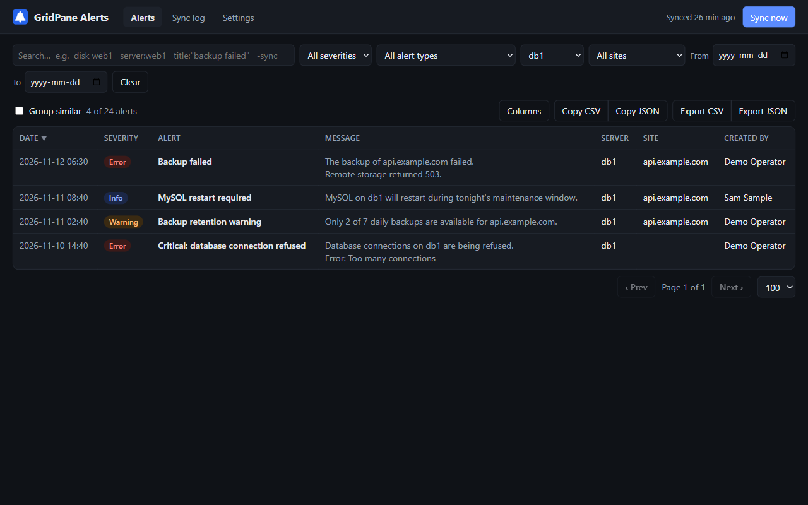
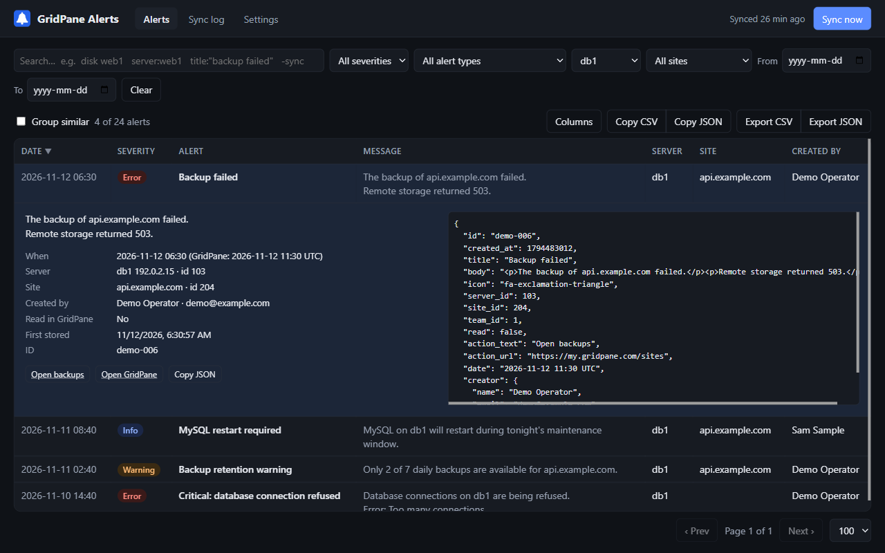
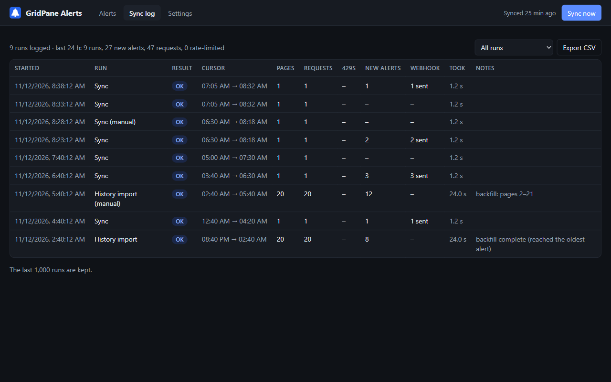
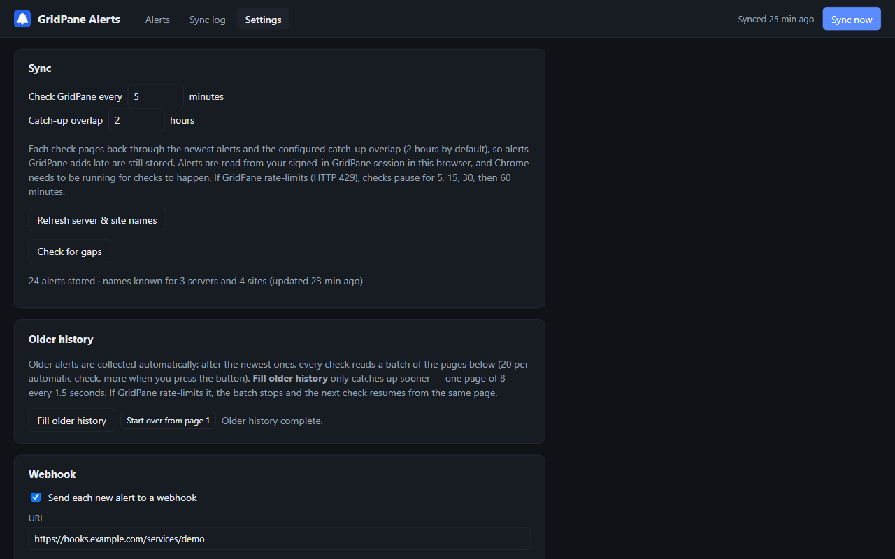

# GridPane Alerts Archive

**Every alert GridPane's bell forgets, kept.** A Chrome extension that archives the alerts in your GridPane notification bell, makes them searchable, and can forward new ones to a webhook.

[](https://github.com/managingwp/gridpane-alerts-extension/releases/latest)
[](./LICENSE)
[](https://developer.chrome.com/docs/extensions/develop/migrate/what-is-mv3)

<table>
  <tr>
    <td width="50%"></td>
    <td width="50%"></td>
  </tr>
  <tr>
    <td width="50%"></td>
    <td width="50%"></td>
  </tr>
</table>

**Documentation:** https://managingwp.github.io/gridpane-alerts-extension/

<!-- BEGIN docs-index -->
**Start here:** [Install](https://managingwp.github.io/gridpane-alerts-extension/getting-started/installation) · [First run](https://managingwp.github.io/gridpane-alerts-extension/getting-started/first-run) · [Sync, history import and gaps](https://managingwp.github.io/gridpane-alerts-extension/guides/sync) · [Search and export](https://managingwp.github.io/gridpane-alerts-extension/guides/search-and-export) · [Webhook](https://managingwp.github.io/gridpane-alerts-extension/guides/webhook)

**Reference:** [Features](https://managingwp.github.io/gridpane-alerts-extension/reference/features) · [Roadmap](https://managingwp.github.io/gridpane-alerts-extension/reference/roadmap) · [Collection and storage](https://managingwp.github.io/gridpane-alerts-extension/reference/collection-and-storage) · [Limits](https://managingwp.github.io/gridpane-alerts-extension/reference/limits)

**Contributing:** [Development](https://managingwp.github.io/gridpane-alerts-extension/contributing/development) · [Release](https://managingwp.github.io/gridpane-alerts-extension/contributing/release) · [Store submission](https://managingwp.github.io/gridpane-alerts-extension/contributing/chrome-web-store) · [The docs site](https://managingwp.github.io/gridpane-alerts-extension/contributing/docs-site)
<!-- END docs-index -->

## Quick start

1. Install the extension: the Web Store listing when it opens, or a release zip loaded unpacked — see [Install](https://managingwp.github.io/gridpane-alerts-extension/getting-started/installation).
2. Keep a **my.gridpane.com** tab open and stay signed in. Chrome does not give the extension GridPane's session cookie, so alerts are read inside that tab.
3. Pin the bell icon. The first sync stores the newest page and starts tracking from there; older history is imported only when you press **Fill older history**.

## What it does

- **Archives on a schedule.** Reads `GET https://my.gridpane.com/notifications/recent?page=N` with your session, every 5 minutes by default (15 seconds to 24 hours in Settings), and never marks anything as read. Each check stops at the last stored alert: it reads the page after the last stored alert once, and stops when that page is already archived.
- **Finds anything.** Stores the full alert text in IndexedDB, with sortable columns, hover-to-copy for message, server and site, field-prefixed search, and CSV/JSON export of the filtered view.
- **Imports history on request.** Fills the bell only when you ask (up to 100 pages per run, then about 20 per check) and audits the archive for gaps.
- **Forwards new alerts.** Posts full JSON, chat text or a Slack card to a webhook you choose, with an id header, an optional HMAC signature and an outbox that retries for an hour, and replays the last N stored alerts (30 by default) to a new endpoint. Settings back up to a local JSON file you can restore.

## Privacy

No account, no analytics, no telemetry and no server of ours. Alerts stay in IndexedDB on your device and leave only for the webhook you configure. Your GridPane cookies and password are never read, and an alert is never marked as read.

## Limits

- Runs only while Chrome is open, and only for the team currently selected in the panel.
- Stores only what GridPane keeps in the notification bell.
- Everything is local to one Chrome profile; uninstalling deletes it, so export first.
- Uses internal panel endpoints, not GridPane's public API.

See [Limits](https://managingwp.github.io/gridpane-alerts-extension/reference/limits) and [Collection and storage](https://managingwp.github.io/gridpane-alerts-extension/reference/collection-and-storage) for the full story.

## For maintainers

There is no build step. The docs site has one of its own, under `website/`.

```bash
node --test
node scripts/package.mjs          # dist/gridpane-alerts-<version>.zip and dist/unpacked/
node scripts/package.mjs --check  # validate only, write nothing
node scripts/flatten-screenshots.mjs store/screenshots  # strip Chrome's alpha from the store captures
```

To release, bump `version` in `manifest.json`, commit, then tag and push:

```bash
git tag v1.7.0
git push origin v1.7.0
```

The `release` workflow runs the tests and validation again, refuses a tag that does not match the manifest version, and attaches the zip to the GitHub Release.

See [Development](https://managingwp.github.io/gridpane-alerts-extension/contributing/development) and [Release](https://managingwp.github.io/gridpane-alerts-extension/contributing/release).

## License

The extension's own code is MIT — see [LICENSE](./LICENSE). The vendored agent skills under `.agents/` are Apache-2.0 from GoogleChrome/modern-web-guidance; see [THIRD-PARTY-NOTICES.md](./THIRD-PARTY-NOTICES.md) and [LICENSES/Apache-2.0.txt](./LICENSES/Apache-2.0.txt).

This is an unofficial extension. GridPane does not publish or support it.
